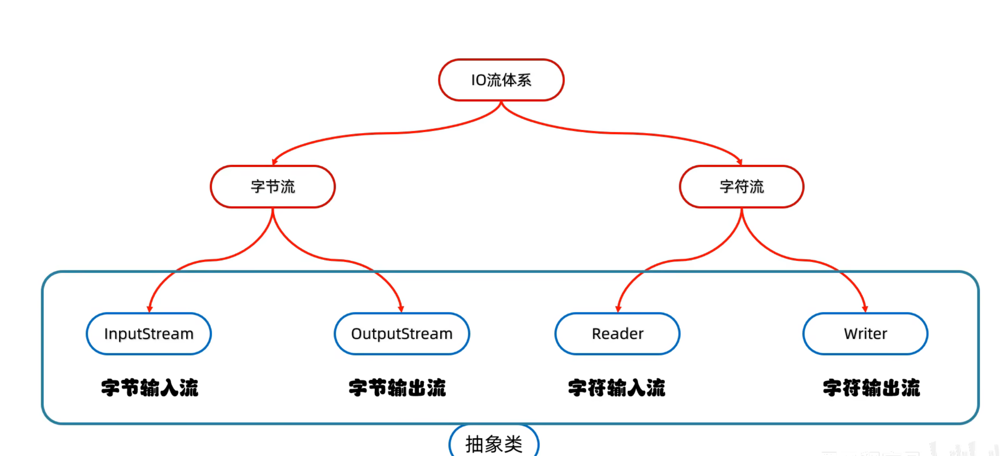
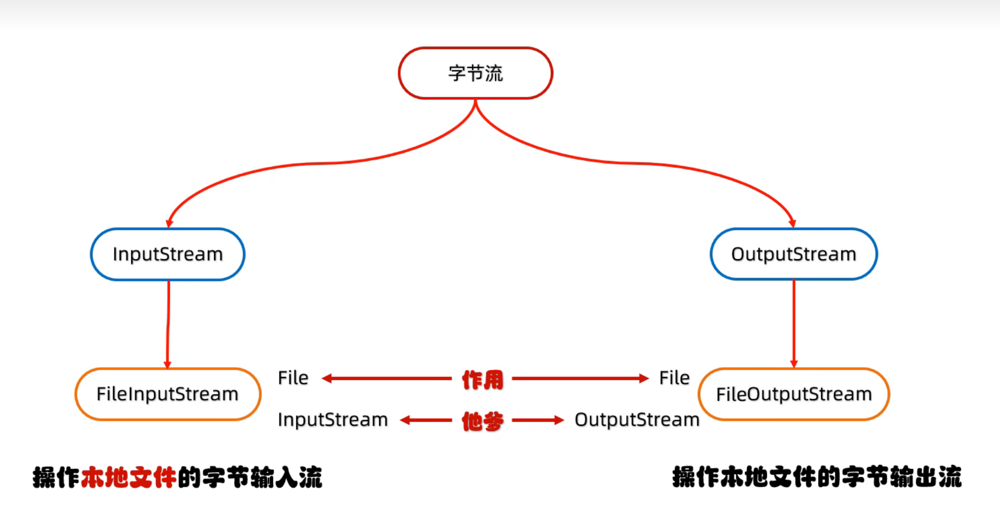
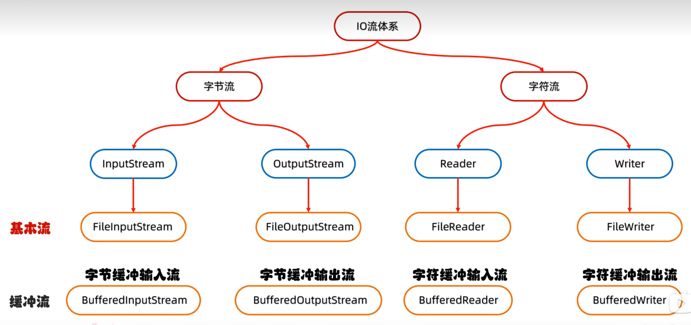
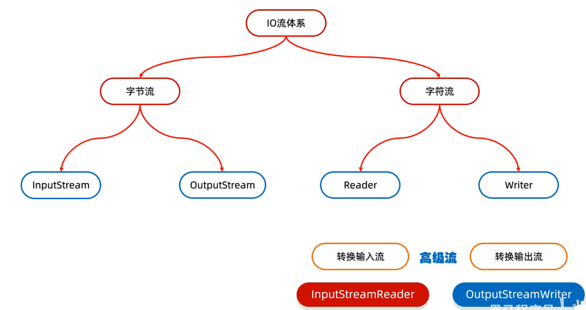
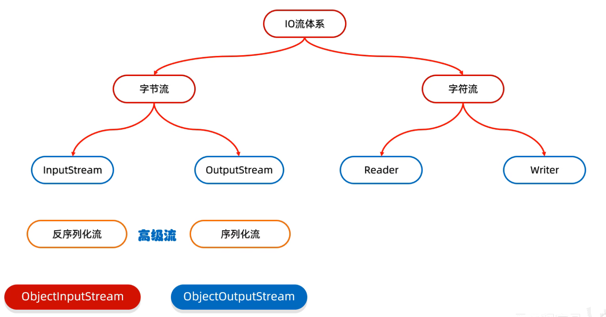
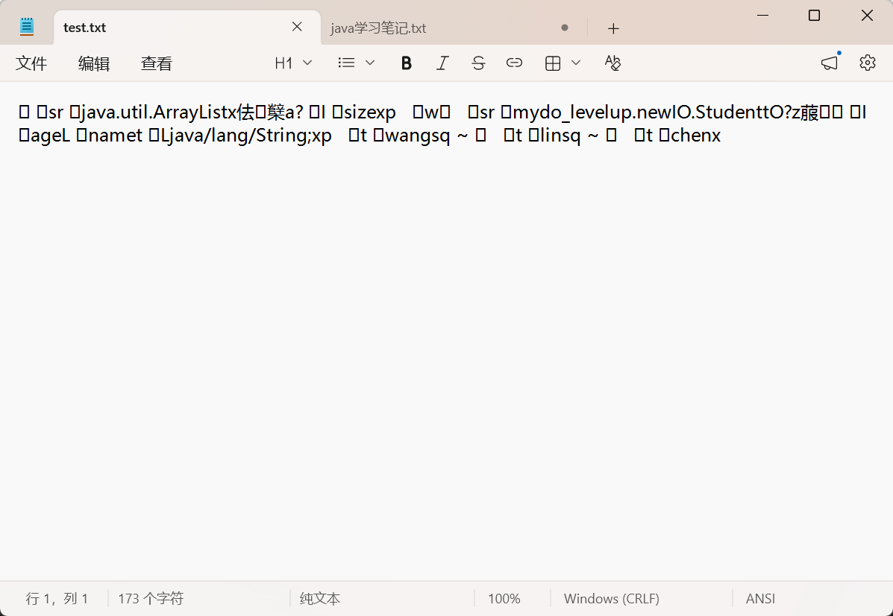
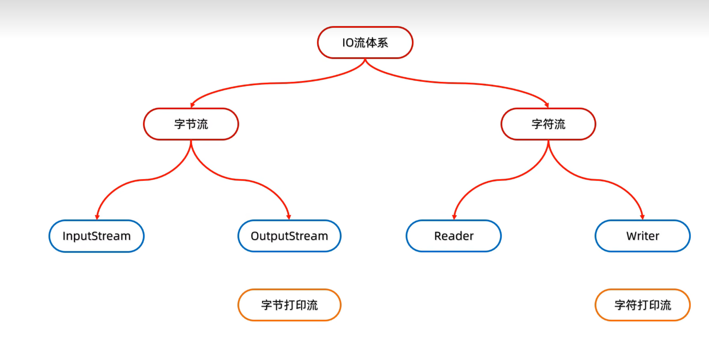
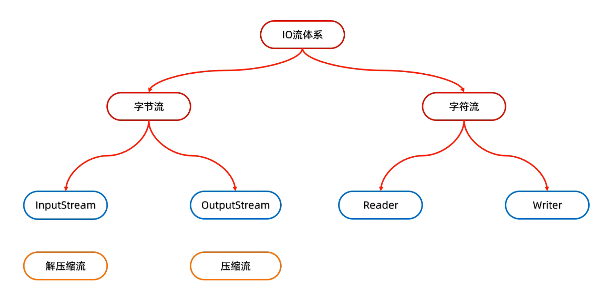

## 前提紧要
这里的io流操作都是基于文件的，所以对于file文件的处理的相关知识一定要了解，如果有些忘记了，建议先去复习一下。

在https://firefly-9vy.pages.dev/posts/javafile/ 里有详细的关于file文件流的使用方式。

## IO流
### IO总览
它是用于读写文件中的数据的一种机制。

分类：
- 在方向上：
  - 输入流
  - 输出流
- 在数据类型上：
  - 字节流（可操作所有文件，适合拷贝文件）
  - 字符流（只能操作纯文本文件，适合读写数据）

注：这里的所有输入输出都是相对这个程序而言的
也就是说，输出是把内容从程序里输出到文件，输入是从文件的到数据到程序

以下是他的体系图：


在接下来，我们会按照字节流和字符流来介绍，然后每个流都有输入和输出流

### 字节流
体系图


#### 字节输出流（FileOutputStream）
- 步骤：
    1. 创建对象（FileOutputStream fos=new FileOutputStream("test.txt");）
    2. 写出数据（.write()）

    这write方法有三个重载版本

    |方法名称|说明|
    |--|--|
    |void write(int b)	|一次写一个字节数据|
    |void write(byte[] b)	|一次写一个字节数组数据|
    |void write(byte[] b, int off, int len)	|一次写一个字节数组的部分数据|
    3. 释放（.close()）

- 小细节：
    - 一，创建对象：
        1. 参数可以是字符串或者file对象
        2. 如果文件地址不存在，会新建这个文件，但是要保证父地址是完整的
        3. 如果文件本身有内容，会被覆盖
    - 二，写出数据：
        1. write方法虽然传入的是整数，但实际上是整数在ASCII上对应的字符
        2. 在文件里换行：使用“\r\n”。
        3. 续写：在创建对象的时候，参数多加一个true，表示续写开关，默认是false


#### 字节输入流（FileInputStream）
- 步骤：
    1. 创建对象
    2. 读取数据（.read）

    有两个重载

    |方法名称|说明|
    |--|--|
    |int read()	|一次读一个字节数据|
    |public int read(byte[] buffer)	|一次读一个字节数组数据（用于大文件的读取）|
    3. 释放（.close()）

- 小细节：
    - 一，创建对象：
        1. 文件地址不存在会直接保存
    - 二，读取数据
        1. 一次读取一个字节，读出来返回的是数据的ASCII对应数字
        2. 读到文件末尾以后会返回-1

#### 应用示例
那么循环读取就可以这么写
```java
    FileInputStream fis=new FileInputStream("test.txt");
    FileOutputStream fos=new FileOutputStream("test2.txt");
    int i=0;
    while((i=fis.read())!=-1){
        fos.write(i);
    }
    fos.close();
    fis.close();
```
结合使用read的重载，read(byte[] buffer)，可以一次性读多个数据，提高效率

它的运行方式是，每次把读到的数据放在传入的数组里，直到数组填满，同时会返回本次读取的长度int length
例如下例，把test1的数据复制到test2
```java
public static void main(String[] args) throws IOException {
        FileOutputStream fos=new FileOutputStream("test1.txt");
        FileInputStream fis=new FileInputStream("test2.txt");
        byte[] b=new byte[1024];
        int len;
        while((len=fis.read(b))!=-1){
            fos.write(b,0,len);
        }
        fos.close();
        fis.close();
```

### 知识补充：字符集
- 我们用的都是GBK字符集：他的汉字存两个字节，英文存一个字节
- 另外我们也常用Unicode字符集
    - 他有UTF-16，UTF-32等编码方式，分别表示统一用16位/32位去保存字符
    - 而UTF-8才最常用，他是用1-4个字节动态保存字符的：中文他用3个字节，英文用1个字节


### 知识补充：乱码
- 产生原因：
    1. 读取数据时没有读完整个汉字
    2. 编码和解码的方式不一致

### 知识补充：编码和解码的方法
- 编码方法

    就是把数据转成字节数组

    |方法名称|说明|
    |--|--|
    |public byte[] getBytes()	|使用默认方式进行编码|
    |public byte[] getBytes(String charsetName)	|使用指定方式进行编码|

- 解码方法

    就是把字节数组还原成数组，因此是构造方法

    |方法名称|说明|
    |--|--|
    |String(byte[] bytes)	|使用默认方式进行解码|
    |String(byte[] bytes, String charsetName)	|使用指定方式进行解码|

### 字符流
本质是字节流加字符集

特点：
    1. 字符输入流（reader）：一次读一个字节，遇到中文时，一次读多个字节
    2. 字符输出流（writer）：底层会把数据按照指定的编码方式进行编码，变成字节再写到文件中

**参考字节流对实现类命名规律，这里同样是“针对对象+执行方式的格式”例如最常见的对纯文本的字符输入流是File+Reader**

#### 字符输入流（FileReader）
- 步骤：
1. 创建字符输入流对象
    |方法名称|说明|
    |--|--|
    |public FileReader(File file)	|创建字符输入流关联本地文件|
    |public FileReader(String pathname)	|创建字符输入流关联本地文件|
     - 细节：
         - 文件地址不存在会报错 
2. 读取数据（read）
    |方法名称|说明|
    |--|--|
    |public int read()	|读取数据，读到末尾返回 - 1|
    |public int read(char[] buffer)	|读取多个数据，读到末尾返回 - 1|
    - 细节：
        - 1：按字节进行读取，遇到中文，一次读多个字节，读取后解码成十进制，如果要以中文汉字或者英文的形式呈现，只需要做一个char类型的强转，因为char类型正好
        - 2：读到文件末尾了，read 方法返回 - 1。
    示例：

    ```java
    File f =new File("C:\\Users\\LY\\Desktop\\files\\aaa.txt");
        FileReader fr=new FileReader(f);
        int i=0;
        while((i=fr.read())!=-1){
            System.out.print((char) i);
        }
    ```
    - 对于有参read（char[] buffer）:
        把读取，解码，强转集合起来了，并把结果放进了buffer数组中，所以我们想要结果只要遍历数组（给的数组足够大，或者文件足够小）或者把数组用string类型拼接。

3. 释放

#### 字符输出流（FileWriter）
步骤
1. 创建字符输出流对象
    |方法名称|说明|
    |--|--|
    |public FileWriter(File file)	|创建字符输出流关联本地文件，默认覆盖写入|
    |public FileWriter(String pathname)	|创建字符输出流关联本地文件，默认覆盖写入|
    |public FileWriter(File file, boolean append)	|创建字符输出流关联本地文件，append=true 开启续写|
    |public FileWriter(String pathname, boolean append)	|创建字符输出流关联本地文件，append=true 开启续写|

    - 细节：
        - 1：参数是字符串表示的路径或者 File 对象都是可以的
        - 2：如果文件不存在会创建一个新的文件，但是要保证父级路径是存在的
        - 3：如果文件已经存在，则会清空文件，如果不想清空可以打开续写开关
2. 写出数据
    |方法名称|说明|
    |--|--|
    |void write(int c)	|写出一个字符|
    |void write(String str)	|写出一个字符串|
    |void write(String str, int off, int len)	|写出一个字符串的一部分|
    |void write(char[] cbuf)	|写出一个字符数组|
    |void write(char[] cbuf, int off, int len)	|写出字符数组的一部分（包括下标）|

    - 细节：
        - 1：如果write方法的参数是整数，但是实际上写到本地文件中的是整数在字符集上对应的字符。
3. 释放


### 字符流底层
- 字符流的输出和输入都存在一个缓冲区，这个缓冲区本质是一个8192字节长的数组。
- 在用read输入的时候，他会先把数据放进缓冲区里，然后再从缓冲区里读取数据，若读取的数据大于8192字节，在超过的时候会将剩余数据覆盖进缓冲区，再去读取数据
- 在用write输出的时候，也会把要输出的数据先放进缓冲区里，然后在执行.close()或者.flush()的时候才把数据真正的写入文件，（这个flush相当于刷新，它不会关闭通道，能继续写入），而如果写入的数据超过了8192字节，他会先把存满缓冲区的数据存进本地文件，然后多出来的数据覆盖缓冲区，直到.close（）


## IO高级流
### IO高级流介绍
是基于基础的字节流或者字符流做了封装，并且加了部分方法

### 一，缓冲流
#### 缓冲流介绍
它在原来基础的字节流或者字符流的基础上，加了一个缓冲区，缓冲区的大小是8192字节。

下面是他的体系图


#### 字节缓冲流
构造方法

|方法名称|说明|
|--|--|
|public BufferedInputStream(InputStream is)	|包装基础字节输入流，内置缓冲区，提升读性能|
|public BufferedOutputStream(OutputStream os)	|包装基础字节输出流，内置缓冲区，提升写性能|

#### 字符缓冲流
由于字符流本就自带缓冲区，所以在这里的效率提升不明显

|方法名称|说明|
|--|--|
|public BufferedReader(Reader r)	|包装基础字符输入流，包装成高级缓冲字符流，提升文本读取性能|
|public BufferedWriter(Writer r)	|包装基础字符输出流，包装成高级缓冲字符流，提升文本写入性能|

针对字符流输入输出的两个方法

|所属流|方法|说明|
|--|--|--|
|BufferedReader（字符缓冲输入流）	|public String readLine()	|读取一整行文本，读到文件末尾没有数据时，返回 null，注意：不会把末尾的换行符\n / \r\n读进来，只返回这一行的文字内容|
|BufferedWriter（字符缓冲输出流）	|public void newLine()	|跨平台换行，自动适配不同操作系统换行标记：Windows：\r\n；Linux/macOS：\n|

### 二，转换流
#### 转换流介绍
他是在字符流基础上的高级流，因此他本质是一个字符流

作用：是字符流和字节流的桥梁，能让字节流变成字符流然后使用对应方法

以下是体系图


#### 转换流使用方式
构造方法
|所属流 | 方法 | 作用|
|--|--|--|
|输入流|InputStreamReader(FileInputStream fi)  |在读取的时候让字节流对象转换成字符流|
|输出流|OutputStreamWrite(FileOutputStream fo)  |在写出的时候让字节流对象转换成字符流|

另外他还有另一种构造，能够解析各种编码格式
|所属流 | 方法 | 作用|
|--|--|--|
|输入流|InputStreamReader(FileInputStream fi,"编码格式")  |让数据以指定的编码格式读取|
|输出流|OutputStreamWrite(FileOutputStream fo,"编码格式")  |让数据以指定的编码格式写入|

但其实这种方式在jdk11以后已经被淘汰了，可以这样想，这个转换流对象本质也是字符流，那为啥不在字符流的构造里加一个能够设定编码格式的构造方法呢

所以我们可以使用字符流的这种构造方式，实现解析各种编码格式
|所属流 | 方法 | 作用|
|--|--|--|
|输入流|FileReader fr=new FileReader("文件地址",charset.forName("编码格式"))  |让数据以指定的编码格取|
|输出流|FileWrite fw=new FileWrite("文件地址",charset.forName("编码格式"))  |让数据以指定的编码格式写入|


### 三，序列化流（对象的输出流）
#### 序列化流介绍
是字节流下的高级流，他的主要作用是把对象信息写进文件中，后续可以通过反序列化流获取信息

以下是体系图

#### 序列化使用方式
基本的构造方法

|构造方法 | 说明|
|--|--|
|public ObjectOutputStream (OutputStream out) | 把基本流包装成高级流|

它对应的写入方法是不一样的

|成员方法 | 说明|
|--|--|
|public final void writeObject (Object obj) | 把对象序列化（写出）到文件中去|

**小细节：如果想要用序列化写入对象，那这个类一定要实现Serializable接口,否则会报NotSerializableException，这个接口是标志性接口，他没有抽象方法，仅作为一个标签表示这个类可以被序列化写入**

### 四，反序列化流（对象的输入流）
#### 反序列化使用方式
基本的构造方法
|构造方法 | 说明|
|--|--|
|public ObjectInputStream(InputStream out) | 把基本流变成高级流|

对应的读取方法是不一样的
|成员方法 | 说明|
|--|--|
|public Object readObject() | 把序列化到本地文件中的对象，读取到程序中来|

**值得关注的是，他的返回值是object的，所以我们还要去强转成原来的类型**


### 关于序列化和反序列化的场景示例
- 序列化和反序列化的基础使用
```java
        Student S1=new Student("wang",18);
        File f1=new File("C:\\Users\\LY\\Desktop\\files\\object.txt");
        //序列化
        ObjectOutputStream oos=new ObjectOutputStream(new FileOutputStream(f1));
        oos.writeObject(S1);
        oos.close();
        //小细节，如果想要用序列化写入对象，那这个类一定要声明Serializable,否则会报错NotSerializableException

        //反序列化
        ObjectInputStream ois=new ObjectInputStream(new FileInputStream(f1));
        Student s2= (Student) ois.readObject();
        ois.close();
        System.out.println(s2);
```
- 细节:
    1. 在做序列化的时候，它会默认产生一串独特的版本号，这个版本号是由javabean类里的成员变量决定的，一旦改动，原先写入的对象版本号就会对不上，此时我们可以选择固定javabean类的版本号
    - 格式：private static final long serialVersionUID=版本号L;
    2. 如果序列化的时候，javabean类的某一属性不希望被写入本地文件，可以在属性的类型名前加一个transient（瞬态关键字）
    - 例如：private transient String address;


- 常见场景：
常常我们序列化对象不只写入一个，在面对多个对象的时候，我们会选择使用集合把对象存起来，再序列化这个集合就行，这样一来就可以解决读取对象的时候无法确定对象个数的问题
代码示例：
```java
    //创建对象
    Student s1=new Student("wang",18);
    Student s2=new Student("lin",18);
    Student s3=new Student("chen",18);
    //创建集合
    ArrayList<Student> list=new ArrayList<Student>();
    list.add(s1);
    list.add(s2);
    list.add(s3);
    
    //开启序列流
    File f1=new File("C:\\Users\\LY\\Desktop\\files\\test.txt");
    ObjectOutputStream oos=new ObjectOutputStream(new FileOutputStream(f1));
    //写入集合
    oos.writeObject(list);
    oos.close();
    //读取对象
    ObjectInputStream ois=new ObjectInputStream(new FileInputStream(f1));
    ArrayList<Student> list2= (ArrayList<Student>) ois.readObject();
    for (Student s: list2) {
        System.out.println(s);
    }
```
代码中的对象存入文档的样子，是看不懂的，如图


### 五，打印流
它只有输出流



#### 字节打印流（PrintStream）
有四个构造方法
|构造方法 | 说明|
|--|--|
|public PrintStream(OutputStream/File/String)	|关联字节输出流 / 文件 / 文件路径|
|public PrintStream(String fileName, Charset charset)	|指定字符编码|
|public PrintStream(OutputStream out, boolean autoFlush)	|自动刷新|   
|public PrintStream(OutputStream out, boolean autoFlush, String encoding)	|指定字符编码且自动刷新|

有四个成员方法
|成员方法 | 说明|
|--|--|
|public void write(int b)	|常规方法：规则跟之前一样，将指定的字节写出|
|public void println(Xxx xx)	|特有方法：打印任意数据，自动刷新，自动换行|
|public void print(Xxx xx)	|特有方法：打印任意数据，不换行|
|public void printf(String format, Object... args)	|特有方法：带有占位符的打印语句，不换行|

**注：这的三个特有方法都支持原样写出，即写出97就是97，而不会按ASCII转成a**

#### 字符打印流（PrintWriter）
多一个缓冲区

有四个构造方法
|构造方法 | 说明|
|--|--|
|public PrintWriter(Writer/File/String)	|关联字节输出流 / 文件 / 文件路径|
|public PrintWriter(String fileName, Charset charset)	|指定字符编码|
|public PrintWriter(Writer w, boolean autoFlush)	|自动刷新|
|public PrintWriter(OutputStream out, boolean autoFlush, Charset charset)	|指定字符编码且自动刷新|

有四个成员方法
|成员方法 | 说明|
|--|--|
|public void write(...)	|常规方法：规则跟之前一样，写出字节或者字符串|
|public void println(Xxx xx)	|特有方法：打印任意类型的数据并且换行|
|public void print(Xxx xx)	|特有方法：打印任意类型的数据，不换行|
|public void printf(String format, Object... args)	|特有方法：带有占位符的打印语句|

**注：这的三个特有方法都支持原样写出，即写出97就是97，而不会按ASCII转成a**

#### 知识补充，我们平时用的标准输出流System.out.print就是一种特别的打印流

### 解压缩流和压缩流
#### 介绍与前提知识补充
这里的压缩包，是由压缩流的构造方法创建的，在这压缩流里存的就是ZipEntry的对象

所以要先了解ZipEntry的构造

|方法 | 说明|
|--|--|
|ZipEntry(String name)|使用指定名称创建新的 ZIP 条目。|

ZipEntry有一个好用的方法
|方法名 | 说明|
|--|--|
|closeEntry()|表示压缩包的一个文件处理完了，可以跳到下一个文件（功能类似循环里的break）|

体系图


#### 解压缩流：
本质是把一个ZipEntry的对象按层级拷贝到本地的另一个文件夹中


解压缩流的构造
|方法 | 说明|
|--|--|
|ZipInputStream(OutStream os)|创建一个解压缩流|

它有一个常用方法，来获取解压出的文件
|方法 | 说明|
|--|--|
|getNextEntry()|会返回一个ZipEntry类的对象，每次执行都会返回具体的文件或者文件夹，内部会自动遍历，包括子文件，遍历完以后会返回null。所以我们只要循环调用它，直到返回null就可以完成对文件的遍历|

##### 解压缩的示例
```java
    File f1=new File("C:\\Users\\LY\\Desktop\\files\\aaa.zip");
    ZipInputStream zis=new ZipInputStream(new FileInputStream(f1));
    ZipEntry ze;
    while((ze=zis.getNextEntry())!=null){
        System.out.println(ze);
    }
```
#### 压缩流
本质是把一个（文件/文件夹）看成ZipEntry对象放在压缩包中

- **在压缩的时候会发现，这里是先put，再去写文件内容的，这乍一看有些反直觉，但其实是小巧思。在压缩流的内部有一个特别的字段能存储put进去的zipentry对象，所以put后再去写入数据是可行的，执行完以后再用closeEntry()，就可以关闭当前的关联。这样的操作因为不用频繁的write会更快，再来就是write方法不好再加一个传入zipentry对象的构造，这会与他的工具类属性有所冲突**

压缩流的构造
|方法 | 说明|
|--|--|
|ZipOutputStream(OutStream)|创建一个压缩流|

有常用方法
|方法 | 说明|
|--|--|
|putNextEntry(ZipEntry A)|将A这个ZipEntry对象放进压缩包中，并且会完整创建里面的文件层级|
|closeEntry()|关闭当前关联的zipEntry对象|
|close()|关闭流|

##### 压缩的示例
- 单个文件的压缩
```java
//先确定要被拷贝的文件流
        File f1=new File("C:\\Users\\LY\\Desktop\\files\\bbb.txt");//这里是要被压缩的文件
        //然后写进压缩流里创建流
        ZipOutputStream zos=new ZipOutputStream(new FileOutputStream(new File(f1.getParent()+"\\"+f1.getName().split("\\.")[0]+".zip")));//如果直接给f1，他会建一个包含f1所有层级的压缩包，所以要拼接
        //然后是读取要被压缩的文件地址，放进ZipEntry对象里
        ZipEntry ze1=new ZipEntry("bbb.txt");//在这里会完整写入层级
        //然后放进流里
        zos.putNextEntry(ze1);
        //要去遍历源文件，写入压缩包里的文件
        FileInputStream fis1=new FileInputStream(f1);
        int i;
        while((i=fis1.read())!=-1){
            //内部的字段会存储这个对象地址,然后执行的写入也会写进对应的地方
            zos.write(i);//写入原文件的数据
        }
        //使用closeEntry()可以关闭当前的文件关联，然后就可以put新的ZipEntry对象了
        zos.closeEntry();
        zos.close();
```
- 文件夹的压缩
```java
public class Test6 {
    public static void main(String[] args) throws IOException {
        //压缩文件夹，那就要考虑几个事
        //1，文件夹需要遍历，判断，那就需要递归
        //2，压缩包位置需要做好拼接

        //先不论别的，先创建被压缩文件流
        File f1=new File("C:\\Users\\LY\\Desktop\\files\\1");
        ZipOutputStream zop=new ZipOutputStream(new FileOutputStream(new File(f1.toString()+".zip")));
        try {
            toZip(f1,zop,f1.getName());
        } catch (IOException e) {
            throw new RuntimeException(e);
        }finally {
            zop.close();
        }

    }

    //需要遍历，那就要声明方法
    //这个方法优先实现对原文件的遍历功能
    //首先需要源文件的流,压缩流，压缩包内部的地址
    public static void toZip(File f1,ZipOutputStream zos,String name) throws IOException {
        File[] files=f1.listFiles();
        for(File file:files){
            if(file.isFile()){
                //是文件
                //要创建zipentry对象
                ZipEntry entry=new ZipEntry(name+"\\"+file.getName());
                //要在压缩流put
                zos.putNextEntry(entry);
                //创建字节输入流
                FileInputStream fis=new FileInputStream(file);
                int i;
                while((i=fis.read())!=-1){
                    //遍历写入
                    zos.write(i);
                }
                fis.close();
                zos.closeEntry();
            }else{
                //是文件夹
                ZipEntry entry=new ZipEntry(name+"\\"+file.getName()+"\\");//在文件名后面加一个\就可以表示空条目
                zos.putNextEntry(entry);
                zos.closeEntry();
                //递归遍历
                //能确定压缩流不变
                //拼接得要遍历得文件夹
                toZip(file,zos,name+"\\"+file.getName());
            }
        }
        //实现遍历，先判断是文件还是文件夹
    }
}
```